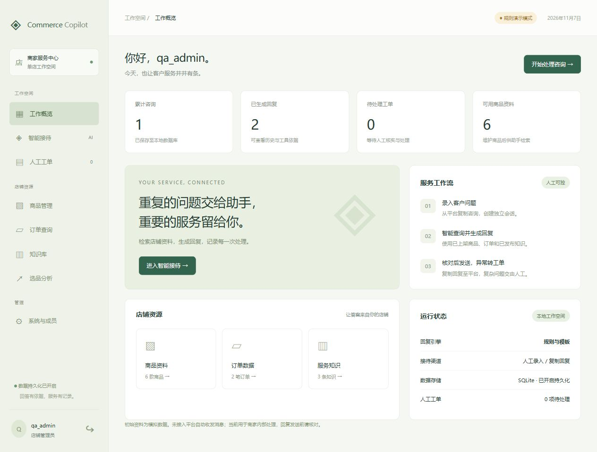

# Commerce Copilot · 商家智能客服工作台

面向**单店商家内部**的 Python + DeepSeek 智能客服系统。统一管理商品、订单与服务知识，通过有依据的回复和人工工单减少重复客服工作。**不包含顾客端**。

当前交付为可本地试运行的工作台：从平台复制咨询 → 助手查询资料并生成回复 → 客服核对后复制发送 → 异常创建工单。**尚未接入电商平台自动收发消息**，不执行真实支付、真实退款或平台订单修改。本地可办理模拟售后。



## 已实现

| 模块 | 行为 |
| --- | --- |
| 工作概览 | 显示实际保存的咨询、回复、待处理工单与资料数量 |
| 登录与成员 | 首次创建管理员；管理员添加、停用和启用成员；客服仅可读资料 |
| 智能接待 | 新建咨询、服务端历史、工具调用依据、复制回复、刷新后恢复记录 |
| 商品管理 | 新增和编辑商品、上架状态、库存、价格、成本及近30天经营指标 |
| 订单查询 | 查询本地订单与物流；可人工维护履约资料，不影响平台订单 |
| 知识库 | 关键词检索、草稿与发布；只有已发布内容进入助手查询 |
| 选品分析 | 基于已录入销量、毛利率和退货率的可解释排名 |
| 退单与退款 | 待付款取消、未发货全额退款、退货审批及验收；均仅本地模拟 |
| 人工工单 | 关联咨询、领取、填写处理结果、标记完成，团队共享处理队列 |
| 数据维护 | JSON 批量新增、校验失败整批回滚、版本冲突保护 |
| 运维 | SQLite 持久化、数据库备份、密码重置及会话撤销、操作审计、CI 测试 |

## 本地启动

需要 Python 3.12+。本地运行与测试无需安装第三方依赖。

```bash
python server.py
```

访问 http://127.0.0.1:8000 ，第一次使用会进入管理员创建页。账号限 3–40 位小写字母、数字、下划线、短横线或点；密码至少 12 位。项目没有默认管理员或内置登录密码。

第一次启动自动导入 `data/demo.json` 中的 **6 款模拟商品、2 笔模拟订单、3 条模拟知识**。之后资料由数据库管理，不会在重启时覆盖编辑结果。不要直接改 `demo.json` 来更新已初始化的店铺，请使用后台。

### 配置 DeepSeek

把 `.env.example` 复制为 `.env`，只在本机填写密钥并重启：

```dotenv
DEEPSEEK_API_KEY=
DEEPSEEK_MODEL=deepseek-flash
```

密钥为空时为**规则演示模式**：关键词路由与模板回答，不能替代真实模型。配置后使用 [DeepSeek 工具调用接口](https://api-docs.deepseek.com/guides/tool_calls/)，非思考模式执行最多 6 轮工具调用。模型名称可根据账号可用模型调整。

启用模型后，对话及相关商品、订单、政策查询结果会发送给 DeepSeek。请先确认店铺资料允许发送至该服务。页面不接收或回显密钥，不在 API 错误中返回上游原始响应。

## 一次完整试用

1. 创建管理员，在“系统与成员”添加一个客服账号。
2. 在“商品管理”修改售价，在“知识库”维护真实、已确认的店铺政策并发布。
3. 进入“智能接待”，输入“查询订单 DEMO1001”或“推荐 100 元以内的商品”。
4. 展开回答下方的依据，核对工具结果；点击“复制回复”供客服发送。
5. 创建人工工单，在“人工工单”中领取，填写处理结果并完成。
6. 刷新页面，重新进入历史咨询，确认记录仍然存在。

初始模拟政策只用于演示。正式使用前请逐条核对；未确定的政策先保留草稿。

## 数据导入

管理员在商品、订单或知识库页面点击“下载导入示例”，填写 JSON 数组后导入。示例只生成空白结构和虚构字段，不导出店铺业务值。

- 单批 1–500 条、文件小于 1 MB；单种资料最多 2000 条。
- 编号只能包含字母、数字、下划线和短横线，且本批不得重复。
- 导入**只新增**；包含已有编号时拒绝整批导入，不覆盖。修改已有记录请用编辑表单。
- 校验售价、成本、库存、退货数及字段长度，任一条失败时不保存本批。
- 订单只收录商品、金额、履约和物流字段，不需要姓名、手机号、地址等个人资料。
- 商品 `active=false` 不参与助手查询；知识 `published=false` 不参与回答。

多人同时编辑时，接口检查 `_version`。过期版本返回 409，要求刷新，避免静默覆盖。

## 权限范围

| 行为 | 管理员 | 客服成员 |
| --- | --- | --- |
| 生成回复、查看商品/订单/知识/选品 | 是 | 是 |
| 查看自己的咨询与历史 | 是 | 是 |
| 查看团队工单及关联咨询 | 是 | 是 |
| 领取工单并完成自己领取的工单 | 是 | 是 |
| 编辑或导入资料 | 是 | 否 |
| 添加、停用成员及读取审计 | 是 | 否 |

咨询默认仅创建人可见；创建工单后，关联咨询进入单店内部共享队列。该系统没有多租户隔离，不应把不同商家的数据放进同一个数据库。

## 架构与关键约束

```text
浏览器后台（原生 HTML / CSS / JS）
                   ↓ 同源 JSON + HttpOnly Cookie + CSRF Token
server.py：WSGI 路由 / 身份 / 权限 / 限流 / 并发控制
       ↓                             ↓
agent.py：规则 / DeepSeek 工具循环    store.py：事务 / 校验 / 审计
       ↓ 每次请求的数据快照            ↓
商品查询 / 订单查询 / 政策检索 / 选品计算
                   ↓
              SQLite（WAL）
```

模型可在明确办理指令下提交本地模拟售后申请；不能调用真实支付、退款接口或自主审批。对话历史从数据库读取，拒绝客户端提交 system/tool 或任意 history。相同会话中的模型请求互斥；相同 `request_id` 重试返回先前结果，不重复落库。模型失败时释放占用且不保存伪造成功记录。单会话上限 200 轮，最近 20 条历史进入模型上下文。

选品得分 = 30 天销量 × 毛利率 × (1 − 退货率)，毛利率 = (售价 − 成本) / 售价。未计广告、物流或平台费用；仅作排序参考，不是市场预测。

知识检索是可编辑关键词匹配，不是向量检索。未知政策会提示人工核实；模型生成仍须人工审核。模板模式的理解和多轮能力有限，真实智能客服效果需配置模型后用店铺咨询样本评估。

## 测试

```bash
python -m unittest discover -s tests -v
node --check web/app.js
```

测试覆盖预算筛选、工具往返、数据库持久化、登录、CSRF、角色权限、账号停用、咨询归属、重复请求、并发冲突、导入事务、草稿隔离与完整工单流转。测试数据库创建在忽略的 `data/private/` 下，独立于店铺资料。

前端已通过浏览器检查：登录、修改商品后立即查询新价格、订单回复、工单创建/领取/完成、刷新恢复咨询。真实 DeepSeek 调用需要本地密钥与额度，未配置时未验证线上回复质量。

## 备份与账号恢复

在项目目录执行：

```bash
python manage.py backup data/private/backups/commerce-backup.sqlite3
python manage.py reset-password your_username
```

备份命令使用 SQLite backup API，目标文件已存在时拒绝覆盖。备份包含店铺资料、对话和密码哈希，须保存在私有目录；不要提交到 Git。密码在隐藏输入中填写，重置后撤销该用户所有登录会话。

恢复备份：先停止服务，保留当前数据库的备份，将 `.env` 中 `COMMERCE_DB` 指向待恢复文件的副本，再启动并核对数据。不要在服务运行时直接覆盖 SQLite 主文件或遗漏 WAL 数据。

## 部署与下一步

详见 [部署说明](docs/deployment.md)。可用 Waitress + HTTPS 反向代理运行单进程、小团队实例。默认只监听本机；开发服务器不能作为生产接入层。

要做到平台自动接待，仍需商家的平台名称、合法接口授权、消息收发接口、订单权限及平台沙箱。接入后还需完成样本评估、人工兜底规则和真实业务验收。当前没有平台自动回复、向量知识库、自动退款、多商家 SaaS 或无人值守经营承诺。

## 文件

`server.py` 服务与权限；`store.py` 数据与事务；`agent.py` 工具和模型；`manage.py` 运维；`web/` 后台；`data/demo.json` 模拟种子；`tests/` 测试；`docs/` 部署说明。运行中的数据库、日志、`.env` 与备份均排除在 Git 之外。

## 退单与退款（本地模拟）

在“退单与退款”提交售后；也可在智能接待明确输入“请申请订单 DEMO1002 退款，原因：不需要了”。提问或否定指令不会自动申请。初始 DEMO1002 为待发货、89元，可验证小额自动模拟流程；DEMO1001 已发货，需退货审批和验收。

- 待付款：自动模拟取消，退款金额为零。
- 未发货：仅支持全额退款。金额不超过100元自动模拟完成，超过100元等待管理员审核。
- 已发货/已完成：提交退货退款，管理员批准后等待退货；登记验收说明后才模拟完成。
- 客服可申请，只有管理员可批准、驳回或确认验收。拒绝重复售后与重复审批；订单状态、金额或版本变化时拒绝按旧记录退款。
- 金额由服务器从订单读取，以整数分记录，不接受模型或前端指定退款金额。暂不支持部分退款、自动退库存、自动验收或退货运费结算。

模拟执行只更新本地订单和售后记录，**未发生真实资金划转**。全额退款金额仅按当前订单录入金额核定，尚未对接支付实收、优惠分摊与平台退款账本。100元为本地演示规则，不代表商家的真实授权额度。真实上线必须接入平台并另行确定规则。
